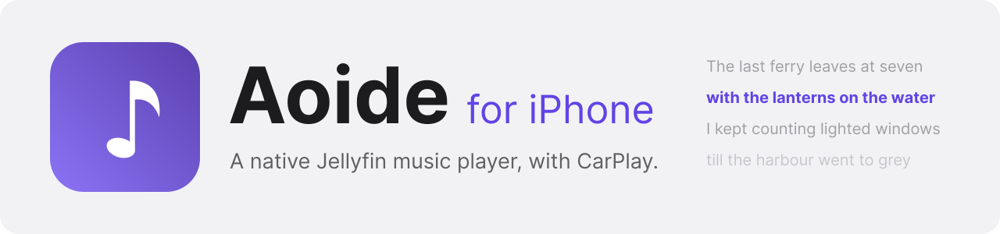
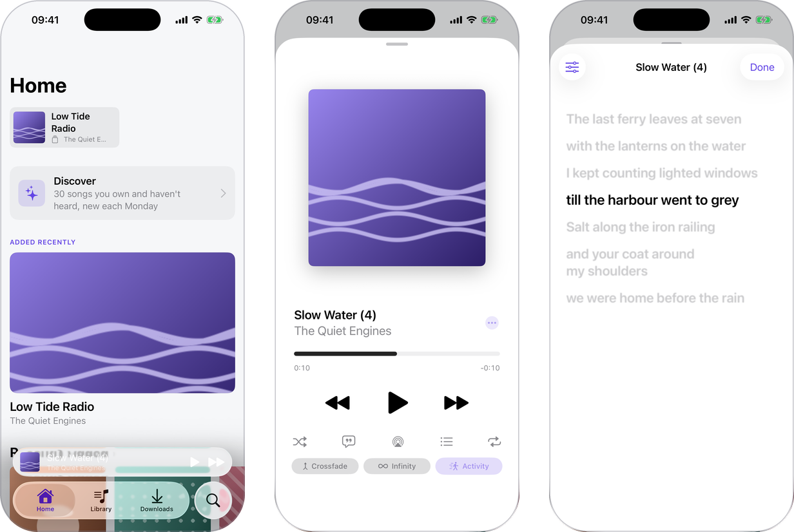
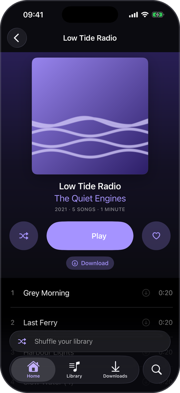
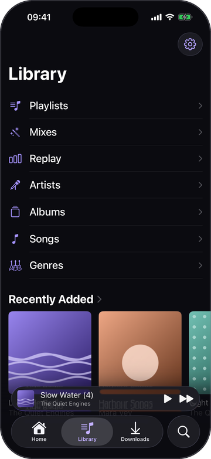
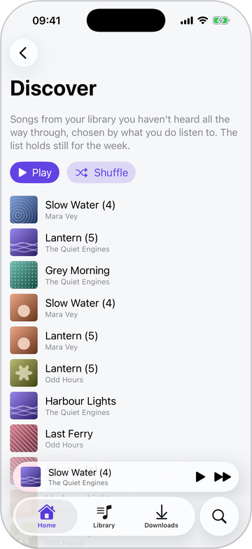
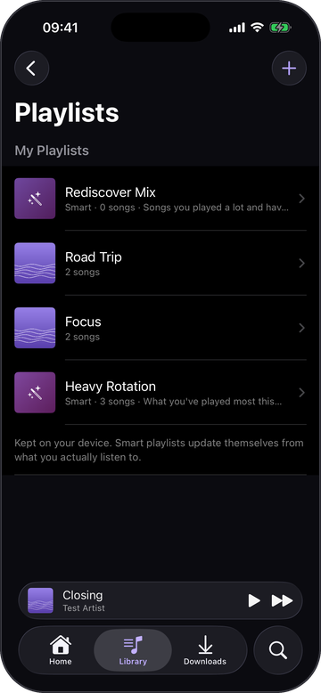

<div align="center">

<picture>
  <source media="(prefers-color-scheme: dark)" srcset="docs/assets/banner-dark.svg">
  <source media="(prefers-color-scheme: light)" srcset="docs/assets/banner-light.svg">
  
</picture>

**A music player for your own Melete server, built to look and feel like Apple Music, in sync with Aoide on Linux.**

[](#requirements)
[](https://www.swift.org)
[](#building)
[](LICENSE)

[Features](#features) · [Requirements](#requirements) · [Building](#building) · [Privacy](#privacy) · [The Aoide family](#the-aoide-family) · [Security](SECURITY.md) · [Changelog](CHANGELOG.md)

<picture>
  <source media="(prefers-color-scheme: dark)" srcset="docs/screenshots/overview-dark.png">
  <source media="(prefers-color-scheme: light)" srcset="docs/screenshots/overview-light.png">
  
</picture>

</div>

Aoide is a native iOS app for the music on your [Melete](https://github.com/Virel0/Melete)
server: big artwork,
synced lyrics, CarPlay, Siri, and a library that behaves like a library.

It plays what is on your server and keeps what is yours on the phone:
playlists, smart playlists, likes, taste flags and an honest play history, all
synced between devices through Melete, which keeps Aoide's sync log itself.
The [Linux app](https://github.com/Virel0/Aoide-Linux) reads and writes
the same data, so a playlist made on the phone is on the desk and a play at the
desk counts on the phone.

## Features

<table>
<tr>
<td width="50%" valign="top">

### Listening
- **Now Playing** with the artwork large, and **synced lyrics** corrected for Bluetooth latency
- Lyrics translated **on the phone** with Apple's Translation framework, offered only when they aren't in your language
- **Gapless** playback. FLAC downloads are converted to Apple Lossless on the phone, which plays gapless where FLAC does not (measured: 67 ms of stall per boundary against none)
- **Trim Silence**: each file is measured once for where its sound actually starts and stops, and only that span plays
- Crossfade (off by default), Keep Albums Whole, and **Infinity** to keep the queue going
- CarPlay, Siri, SharePlay and AirPlay

### Library
- **Home** opens on the last things you were in, each one tap from playing, and a tile to pick up where another device was playing more recently
- **Discover** on Home: 30 songs you own and haven't heard through, chosen by your taste and the same all week
- Artists, albums, songs, genres, playlists, mixes and Replay
- **Search** that understands a sentence, on the phone
- **Downloads** shown as what you downloaded: playlists, albums, then songs

</td>
<td width="50%" valign="top">

### Playlists
- Kept on the device and synced, with **folders**, chosen covers, and drag-to-reorder that survives two devices reordering at once
- **Smart playlists** whose rules re-run every time they are opened; *Rediscover Mix* and *Heavy Rotation* are built in
- **Mixes**: describe a mood and get a queue, built on the phone with Apple Intelligence. The model writes rules; the rules pick the songs
- **Import a Spotify playlist** and see what your server has and what it lacks

### History and taste
- **Replay**: this month, this year or all time, from the play history
- **Taste flags**: *Not Interested* keeps a track out of mixes, stations, shuffle and every smart playlist; *Don't Count Plays* keeps it out of the history
- Activity tags on plays: Gaming, Focus, Chores, Commute

### Across devices
- Playlists, folders, likes, taste flags and plays synced with the Linux app through Melete
- A queue you can hand to another device

</td>
</tr>
</table>

<table>
<tr>
<td width="25%"></td>
<td width="25%"></td>
<td width="25%"></td>
<td width="25%"></td>
</tr>
</table>

The screenshots are from the iOS Simulator, signed in to a stand-in test server
with made-up artists, albums and lyrics.

## The Aoide family

- **Aoide for iPhone** (this repository): the iOS app, in SwiftUI, with CarPlay and Siri.
- **[Aoide for Linux](https://github.com/Virel0/Aoide-Linux)**: the desktop app, in Rust, with a pacman repository, a Flatpak, an AppImage and a deb.
- **[Melete](https://github.com/Virel0/Melete)**: the media server both apps play from and sync through.

Aoide was one of the three original Muses in Greek myth; the name means "song".

## Requirements

- An iPhone on iOS 26 or later. Mixes and sentence search need Apple Intelligence.
- A Melete server. Developed against 0.1.

## Building

The app isn't on the App Store; you build it with Xcode. Open
`Aoide.xcodeproj` in Xcode 26 and run. Two things are yours to supply, and
neither is committed:

```sh
cp Config/Local.example.xcconfig Config/Local.xcconfig
```

Then fill in `DEVELOPMENT_TEAM` (your Apple Team ID) and, optionally,
`AOIDE_DEFAULT_SERVER`, the address the sign-in screen offers on a fresh
install. The bundle identifier is `AOIDE_BUNDLE_ID` in the same file; use your
own. A clean checkout builds as `com.example.aoide`, signed with no team, which
is enough for the simulator.

CarPlay is a per-app entitlement granted by Apple on request, so a build under
another identifier plays music but does not appear in the car until Apple says
so. Siri and SharePlay are self-service: tick SiriKit and Group Activities on
your App ID. `Config/Aoide.entitlements` explains each one.

### Tests

The logic lives in three local Swift packages, so it can be tested without a
simulator:

```sh
cd Packages/CurationKit && swift test    # store, op log, sync, smart playlists
cd Packages/MeleteKit && swift test      # API client, import matching
cd Packages/PlaybackKit && swift test    # queue, conversion, silence bounds
```

### Design notes

`docs/sync-design.md` is the contract the apps and Melete's sync all implement.
`docs/taste-flags.md` and `docs/sound-bounds.md` are the two later additions.
The other files in [docs/](docs) are design briefs (audio analysis, Infinity,
Discover, activity tags, crossfade) and the record of Auto DJ, which is
shelved.

## Privacy

Aoide has no account of its own, no analytics, and no servers run for it.

| Where | What is sent | When |
|---|---|---|
| Your Melete server | Sign-in, library requests, streams and downloads, the sync log (playlists, likes, taste flags, plays), Discover, Infinity, import matching, measurements | Always |
| Spotify | A request for the public playlist page you paste; nothing about you | Only when you import a playlist |
| Apple | Siri requests, if you allow Siri; the system downloads a translation language once, the first time it is needed | Only for those features |

Mixes, sentence search and lyric translation run on the phone; your
descriptions and the lyrics do not leave the device. The sign-in token is kept
in the keychain. Playlists, likes, taste flags, the play history and downloads
are kept on the phone, and synced to your own server.
The full policy is [docs/privacy-policy.md](docs/privacy-policy.md).

## Licence

GPL-3.0-or-later; see [LICENSE](LICENSE).
